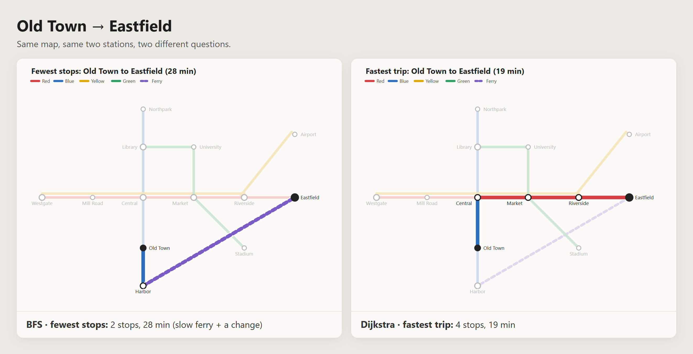
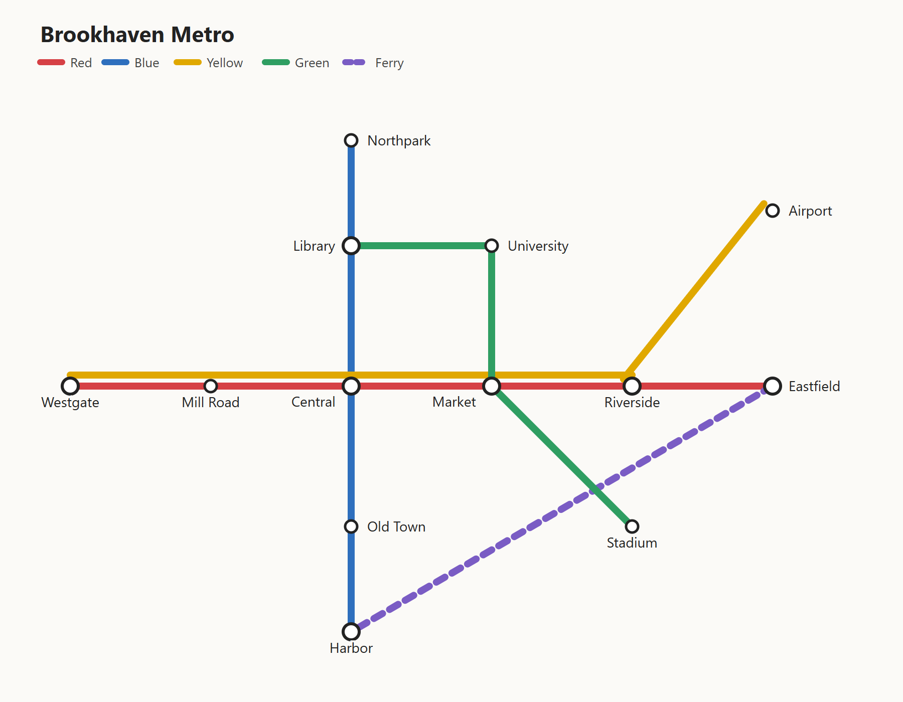
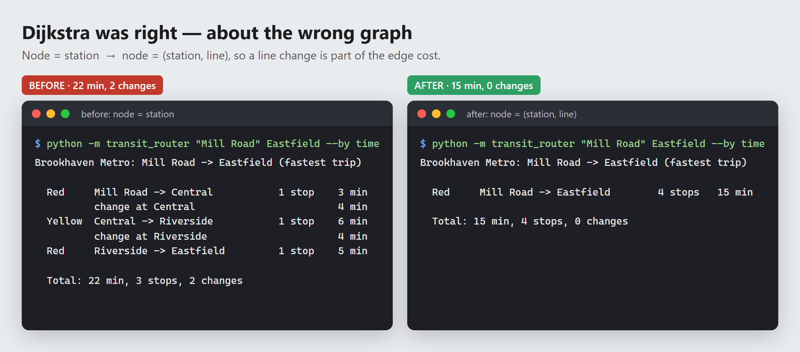
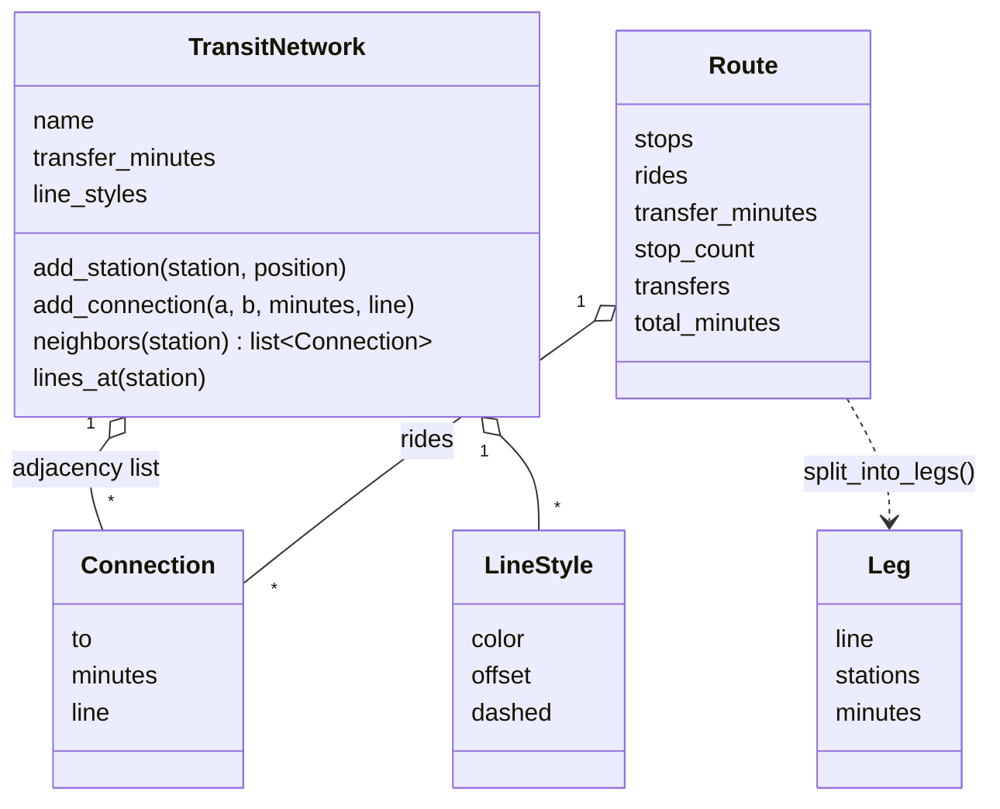
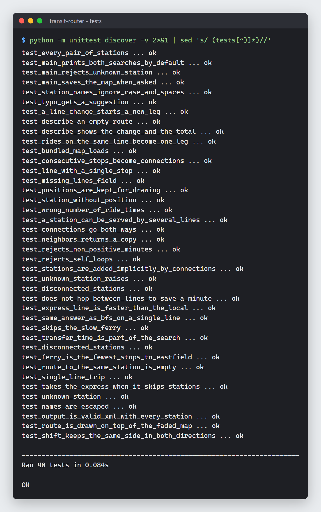

# transit-router

A small route planner for a made-up city metro. Given two stations it answers
two different questions:

- **Fewest stops** — which route passes through the fewest stations? (BFS)
- **Fastest trip** — which route gets me there first, counting the time lost
  changing lines? (Dijkstra)

They are often not the same route, and finding out why was the point of this
project. It's my practice ground for graphs from my Advanced Data Structures
course.

Plain Python 3, standard library only (tested on 3.14).



## Try it

```text
$ python -m transit_router "Old Town" Eastfield
Brookhaven Metro: Old Town -> Eastfield (fastest trip)

  Blue    Old Town -> Central            1 stop    3 min
          change at Central                        4 min
  Red     Central -> Eastfield          3 stops   12 min

  Total: 19 min, 4 stops, 1 change

Brookhaven Metro: Old Town -> Eastfield (fewest stops)

  Blue    Old Town -> Harbor             1 stop    4 min
          change at Harbor                         4 min
  Ferry   Harbor -> Eastfield            1 stop   20 min

  Total: 28 min, 2 stops, 1 change
```

Other options:

```text
python -m transit_router --list                        # every station and its lines
python -m transit_router Westgate Airport --by time    # only one search
python -m transit_router "Old Town" Eastfield --svg trip.svg   # save the map with the route
python -m transit_router A B --map my_city.json        # use your own map
```

Station names ignore case and extra spaces, and a typo gets a suggestion
(`Unknown station 'Libary'. Did you mean: Library?`).

## The map



`data/brookhaven.json` describes 13 stations and 5 lines. A line is written the
way a timetable reads — ordered stops plus the ride time between each pair:

```json
{
  "name": "Red",
  "color": "#d64045",
  "stops": ["Westgate", "Mill Road", "Central", "Market", "Riverside", "Eastfield"],
  "minutes": [4, 3, 3, 4, 5]
}
```

Changing lines costs `transfer_minutes` (4 on this map). The map is small on
purpose, but it has the cases that make routing interesting: an express line
(Yellow) that skips stations, and a ferry that is few stops but slow.

## How it works

The network is an **undirected weighted graph stored as an adjacency list**
(`dict` of station → list of connections). A metro map is sparse — most
stations touch two or three others — so an adjacency matrix would be mostly
empty.

**Fewest stops — BFS.** BFS explores one "ring" of stations at a time, so the
first time it reaches the goal it has used the fewest rides. Each station
remembers where it was reached from, and the path is rebuilt backwards from the
goal.

**Fastest trip — Dijkstra on (station, line) pairs.** This is where I got it
wrong first. My first Dijkstra used stations as nodes and ride minutes as edge
weights, then added the transfer time to the total at the end. It happily
answered *Mill Road → Eastfield* with Red → Yellow → Red: one minute less riding
than staying on Red, but two 4-minute changes, so 22 minutes instead of 15.

The search couldn't avoid changes because a node that is just "Central" doesn't
know which train you arrived on. The fix was to change what a node is: a node
is now `(station, line)`. Riding keeps the line; boarding a different line adds
the transfer time to that edge. All costs are still non-negative, so Dijkstra's
guarantee holds.



**Checking it with brute force.** `tests/test_brute_force.py` lists every
simple path between every pair of stations with a recursive DFS, prices each
one, and compares the minimum with both searches — 169 pairs. Running it
against the old station-only Dijkstra, 30 of the 169 pairs failed.

## Design



| Module | Job |
| --- | --- |
| `network.py` | the graph: stations, connections, line styles |
| `loader.py` | reads and validates the JSON map |
| `routing.py` | `fewest_stops` (BFS), `fastest_trip` (Dijkstra), `Route` |
| `itinerary.py` | groups rides into legs and prints directions |
| `svg_map.py` | draws the map and a highlighted route as SVG |
| `__main__.py` | the command line |

A few decisions:

- **Searches are functions, not methods on the network.** The network only
  knows its shape; the searches only need `neighbors()`. Adding another search
  doesn't touch the graph class.
- **`heapq` with "lazy deletion"** instead of a decrease-key: when a node gets a
  better time I push a new entry and skip stale ones when they come out.
- **SVG by hand.** SVG is XML text, so drawing the map is string building — no
  plotting library to install. Labels go on the first side of the station with
  no track within 90°.

## Tests

```text
python -m unittest discover -v
```

40 tests: the graph, the loader's validation, both searches (including the
transfer regression tests), the brute-force check, the directions text, the
CLI and the SVG output.



## What I'd do next

- Let the user say "avoid the ferry" (remove a line before searching).
- Time-of-day timetables: trains that only run every 10 minutes make the wait
  part of the cost, which is a much harder problem.
